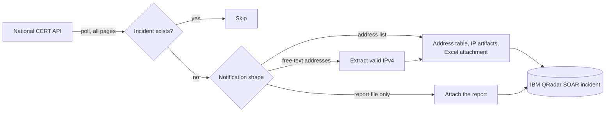

# National CERT Feed Case Automation

[](https://github.com/AtakanUk/national-cert-feed-case-automation/actions/workflows/ci.yml)

[](LICENSE)

Turns vulnerability notifications from a national CERT into IBM QRadar SOAR incidents. Organisations receive these notifications when a CERT finds one of their internet-facing assets exposed: an open RDP port, a vulnerable VPN gateway, a compromised website. They have to be acknowledged and fixed within a deadline, so missing one is not an option. This collector polls the CERT API and opens one incident per notification, with everything the analyst needs already attached.



## What the incident contains

Notifications arrive in three shapes, and each one is handled:

| Shape | Incident content |
| --- | --- |
| Structured list of affected addresses (IP, port, protocol, time seen) | Address table field, IP list field, one `IP Address` artifact per unique IP, and an Excel attachment for the network team |
| Only a report file (usually PDF) | The file is downloaded from the API and attached |
| Free-text address field | IPv4 addresses are extracted (invalid ones such as `999.1.1.1` are dropped) and handled like the structured case |

Each incident also gets the CERT's description, explanation and recommended action, plus a link back to the notification in the CERT portal.

## Commands

| Command | Purpose |
| --- | --- |
| `collect` | Poll notifications of the last `LOOKBACK_SECONDS` (all pages), skip the ones that already have an incident (`cert_case_id` within `DEDUP_DAYS`), and create the rest. One failing notification does not stop the run; the exit code is `1` if anything failed. |
| `repair` | Re-create the evidence attachment of incidents that ended up without one (for example after an attachment upload error). |
| `healthcheck` | End-to-end check for the weekly report: API reachable over TCP, API query works, latest notification has an incident, and that incident has its attachment. |
| `show ID` | Print a parsed notification. |

```bash
pip install -e .
cp .env.example .env
cert-feed collect
cert-feed healthcheck --days 7
```

Cron:

```cron
*/10 * * * * cd /opt/cert-feed && .venv/bin/cert-feed collect >> logs/collect.log 2>&1
0 8 * * 1    cd /opt/cert-feed && .venv/bin/cert-feed healthcheck >> logs/health.log 2>&1
```

## SOAR fields

The incident uses these custom fields; create them in SOAR, or rename them in `normalization.py`:

| Field | Type |
| --- | --- |
| `cert_case_id` | number (used for de-duplication) |
| `cert_code` | text |
| `cert_description`, `cert_explanation`, `cert_action` | text area (rich text) |
| `cert_address_table` | text area (rich text) |
| `cert_ip_list` | text |

## Configuration

See `.env.example`: API URL and token (with optional proxy), the portal link template, the polling window, the de-duplication window and the SOAR connection and incident types.

## Tests

```bash
pip install pytest
pytest
```

The tests cover all three notification shapes, incident and artifact building, the Excel attachment, de-duplication, failure isolation and the attachment repair.

## License

[MIT](LICENSE)
